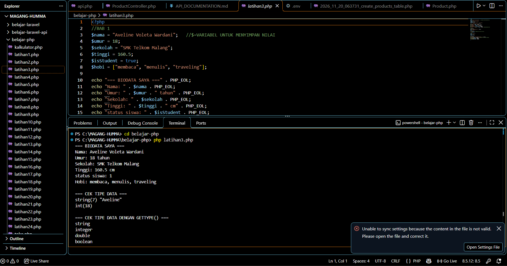
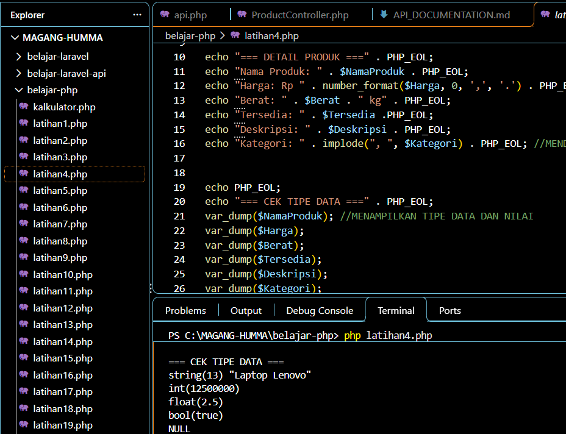
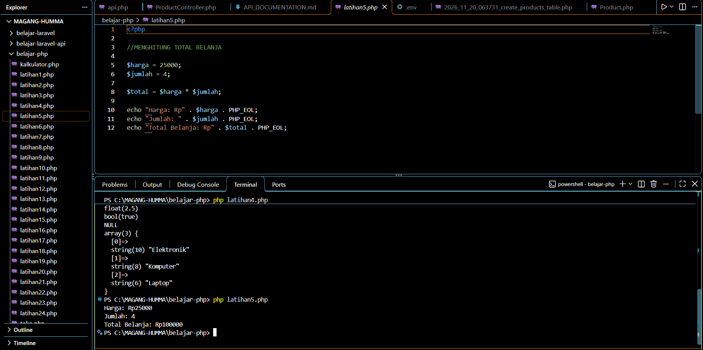
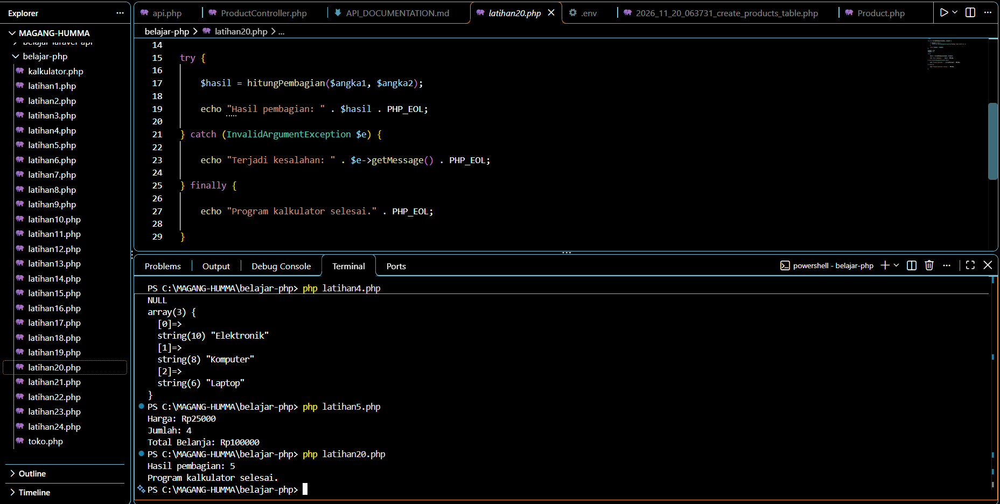
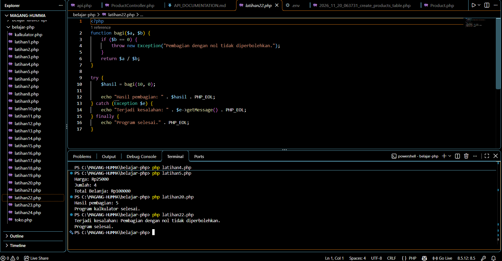

# LAPORAN PEMBELAJARAN 1: FUNDAMENTAL PROGRAMMING PHP

**Nama:** Aveline Voleta Wardani  
**Topik Pembelajaran:** Dasar Pemrograman PHP (Variabel, Konstanta, Tipe Data, Operator, dan Error Handling)  
**Periode:** 17 November 2026 – 23 November 2026

---

## 1. Pendahuluan

Pada periode pembelajaran ini, saya mempelajari Fundamental Programming menggunakan bahasa pemrograman PHP sebagai dasar untuk memahami pengembangan aplikasi Backend. Pembelajaran berfokus pada konsep dasar penyimpanan data, pengolahan nilai, serta penanganan kesalahan dalam program.

Proses pembelajaran dilakukan melalui pemahaman materi, pengamatan contoh kode, dan latihan praktik menggunakan Visual Studio Code serta PowerShell. Materi yang dipelajari meliputi variabel, konstanta, tipe data, operator, dan error handling.

## 2. Daftar Materi Pembelajaran

### 2.1 Variabel

Memahami cara mendeklarasikan, memberikan nilai, memanggil, dan mengubah nilai variabel menggunakan PHP. Variabel digunakan untuk menyimpan data yang nilainya dapat berubah selama program dijalankan.

### 2.2 Konstanta

Mempelajari penyimpanan nilai tetap menggunakan `const` dan `define()`, serta memahami perbedaan penggunaannya dengan variabel.

### 2.3 Tipe Data

Mengenal tipe data `string`, `integer`, `float`, `boolean`, `array`, dan `null`. Mempelajari penggunaan `var_dump()` dan `gettype()` untuk memeriksa tipe data suatu variabel.

### 2.4 Operator

Mempelajari operator aritmatika, assignment, perbandingan, dan logika untuk melakukan operasi matematika, mengubah nilai variabel, serta membandingkan dan menggabungkan kondisi. Termasuk memahami perbedaan operator `==` dan `===`.

### 2.5 Error Handling

Mempelajari cara mengenali dan menangani kesalahan dalam program PHP. Materi mencakup jenis kesalahan seperti syntax error, runtime error, dan logic error, serta penggunaan `try`, `catch`, `finally`, `throw`, dan `getMessage()` untuk menangani exception.

## 3. Implementasi Kode dan Praktik

Seluruh materi diterapkan melalui latihan kode PHP sederhana untuk memahami cara kerja setiap konsep dan melihat hasilnya secara langsung melalui terminal.

### 3.1 Praktik Variabel dan Konstanta

Membuat program sederhana yang menyimpan informasi seperti nama, umur, alamat, dan informasi lainnya menggunakan variabel. Selain itu, mencoba penggunaan `const` dan `define()` untuk membuat konstanta serta memahami perbedaan nilai yang dapat dan tidak dapat diubah.

### 3.2 Praktik Tipe Data

Membuat beberapa variabel dengan tipe data berbeda, kemudian memeriksa jenis dan nilai datanya menggunakan `var_dump()` dan `gettype()`. Praktik juga dilakukan pada tipe data array menggunakan fungsi `implode()` untuk menggabungkan elemen array menjadi sebuah teks.

### 3.3 Praktik Operator

Membuat latihan operasi matematika, perubahan nilai variabel, perbandingan menggunakan `==` dan `===`, serta penggunaan operator logika untuk menggabungkan beberapa kondisi.

### 3.4 Praktik Error Handling

Mempelajari cara mengidentifikasi kesalahan pada program, kemudian mencoba menangani exception menggunakan `try` dan `catch`. Selain itu, mempraktikkan penggunaan `throw` untuk menghasilkan exception secara manual, `getMessage()` untuk mengambil pesan kesalahan, serta `finally` untuk menjalankan kode yang tetap dieksekusi setelah proses penanganan exception.

### 3.5 Dokumentasi Praktik

**1. Latihan Variabel dan Konstanta**

**2. Latihan Tipe Data**

**3. Latihan Operator**

**4. Praktik Try-Catch**

**5. Praktik Throw dan Finally**

## 4. Rekapitulasi Konsep Teknis

| Konsep | Fungsi Utama |
|---|---|
| Variabel | Menyimpan data yang nilainya dapat berubah. |
| `const` | Membuat konstanta dengan nilai tetap. |
| `define()` | Mendefinisikan konstanta melalui fungsi PHP. |
| String | Menyimpan data teks. |
| Integer | Menyimpan bilangan bulat. |
| Float | Menyimpan bilangan desimal. |
| Boolean | Menyimpan nilai `true` atau `false`. |
| Array | Menyimpan kumpulan data dalam satu variabel. |
| Null | Menunjukkan bahwa variabel tidak memiliki nilai. |
| `var_dump()` | Menampilkan informasi nilai dan tipe data. |
| `gettype()` | Memeriksa tipe data suatu variabel. |
| `implode()` | Menggabungkan elemen array menjadi sebuah string. |
| Operator Aritmatika | Melakukan operasi matematika. |
| Operator Assignment | Memberikan atau memperbarui nilai variabel. |
| Operator Perbandingan | Membandingkan dua nilai dan menghasilkan nilai boolean. |
| Operator Logika | Menggabungkan atau membalikkan kondisi. |
| `try` | Menentukan blok kode yang berpotensi menghasilkan exception. |
| `catch` | Menangkap dan menangani exception. |
| `finally` | Menjalankan blok kode setelah proses `try-catch`. |
| `throw` | Menghasilkan exception secara manual. |
| `getMessage()` | Mengambil pesan dari exception. |

## 5. Kendala dan Penyelesaian

Selama proses pembelajaran, terdapat beberapa konsep yang memerlukan pemahaman lebih lanjut, seperti perbedaan penggunaan variabel dan konstanta, perbedaan operator perbandingan `==` dan `===`, serta cara kerja penanganan exception menggunakan `try-catch`.

Untuk mengatasi kendala tersebut, dilakukan latihan menggunakan berbagai contoh nilai dan tipe data, kemudian mengamati hasil eksekusi program melalui terminal. Pada materi error handling, dilakukan percobaan dengan membuat kondisi kesalahan dan exception agar dapat memahami bagaimana program menangani kesalahan tanpa langsung menghentikan seluruh alur program secara tidak terkendali.

## 6. Kesimpulan

Melalui pembelajaran ini, saya memperoleh pemahaman dasar mengenai penggunaan variabel, konstanta, tipe data, operator, dan error handling dalam PHP. Saya juga mampu menerapkan konsep-konsep tersebut melalui latihan program sederhana serta menjalankan dan mengamati hasilnya menggunakan PHP CLI.

Selain memahami cara menyimpan dan mengolah data, saya mulai memahami pentingnya penanganan kesalahan agar program dapat berjalan dengan lebih terstruktur. Materi ini menjadi fondasi untuk melanjutkan pembelajaran ke konsep pemrograman PHP berikutnya dan pengembangan aplikasi Backend.